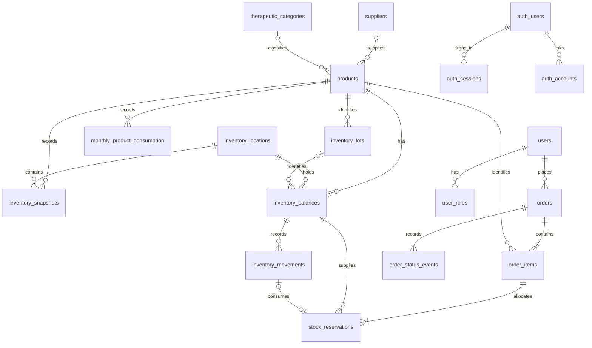

# Current pharmacy data model

This document describes the schema currently in code. The intended
new purchasing system is defined in the [ecommerce data model proposal](ecommerce-data-model-proposal.md),
which covers orders, payments, operational stock and reservations. The
commercial catalog, operational stock, order lifecycle and Better Auth pilot
are implemented. The pilot exposes permission-checked order routes. The web
cart, payment integration and prescription review still need to be connected
to checkout.

The initial schema stores the product catalog and traceable historical
observations. It follows the [supplied project context](context/README.md),
without treating proposal slides or the existing frontend mock as approved
transactional requirements. The first migration creates six tables and does
not import data or change the public API.

## Relationships

`products` includes medications, medical devices, supplements and other catalog
items already present in the source. A product is a distinct external code and
presentation, not just an active ingredient. Multiple products can share an
ingredient or supplier. UUID primary keys keep internal references independent
of external code changes; external codes remain unique text values.

## Tables and fields

### suppliers

`id` is a generated UUID; `name` is required and nonblank. A case-insensitive
unique index on the trimmed name prevents duplicate labels caused only by
letter case or surrounding spaces. Source aliases still need explicit review.
The source mixes supplier and laboratory terminology; this table does not claim
to model manufacturers or procurement contracts.

### therapeutic_categories

`id` is a generated UUID and `name` follows the same nonblank and normalized
uniqueness rules as suppliers. Labels are catalog data, not clinical advice or
an instruction to reclassify products automatically.

### products

| Field | Type | Rule |
| --- | --- | --- |
| `id` | UUID | Generated primary key |
| `code` | Text | Required, unique, nonblank, without surrounding spaces |
| `name` | Text | Required nonblank display name |
| `description` | Text | Optional additional description; null when absent, nonblank when present |
| `quantity_unit` | Text | Required, nonblank, explicitly verified for this product |
| `active_ingredient` | Text | Nullable; preserve combinations and strength as source labels |
| `dosage_form` | Text | Nullable when missing or not applicable |
| `presentation` | Text | Nullable; not a unit-conversion formula |
| `supplier_id` | UUID | Nullable foreign key to `suppliers` |
| `therapeutic_category_id` | UUID | Nullable foreign key to `therapeutic_categories` |
| `sale_condition` | `product_sale_condition` enum | Nullable until classified; no automatic direct-sale default |
| `price_clp` | Integer | Nullable until priced; strictly positive when defined |
| `is_published` | Boolean | Required; defaults to false |
| `inventory_tracking` | `inventory_tracking` enum | Nullable while pending; `quantity_only` or `lot_and_expiration` |

Optional text fields accept null, not blank placeholders. Missing source
attributes do not require fake supplier/category records. Supplier and category
foreign keys are indexed for filtering and reference checks. Deletes of
referenced records are restricted to preserve related observations.

The canonical quantity unit is defined once per product and inherited by both
historical tables. Importing a source with different units requires an approved
conversion first. Do not change this unit after observations exist without
migrating all affected quantities in a controlled transaction.

Publication requires both a non-null price and sale condition. Names are always
required, and prices cannot be zero, negative or fractional. A published product
must be unpublished before removing its price or classification. These database
checks do not replace authorized classification, prescription review, inventory
availability or checkout eligibility.

The enum contains `direct_sale`, `simple_prescription`, `retained_prescription`,
`retained_prescription_stock_control`, `prescription_cheque` and `not_applicable`.
See the proposal's [Chilean sale conditions](ecommerce-data-model-proposal.md#chilean-sale-conditions)
for their meaning and regulatory sources. In particular, publication does not
authorize online purchase of prescription-cheque products. No checkout exists
yet, so that restriction remains a requirement for its eventual implementation.

There is no default price or stock field on `products`. Historical purchasing
costs and valuation totals cannot be reused as current selling prices. The
frontend still uses its mock and is not connected to this commercial schema.

### inventory_locations

`id` is a generated UUID, `code` is required unique trimmed text, and `name` is
required with case-insensitive trimmed uniqueness. This represents the distinct
pharmacy and warehouse stock sources. Do not seed location codes or interpret
`1016`/`1043` until the mapping is confirmed.

`is_active` is required and defaults to true. Disabling a location excludes its
stock from available inventory without removing its history or physical counts.

### inventory_lots

`id` is a generated UUID. `product_id`, trimmed nonblank `lot_number`, finite
`expires_on` date and `created_at` timestamp with time zone are required.
`(product_id, lot_number)` is unique. Lots are allowed only for products with
`lot_and_expiration` tracking; the pharmacy must assign that policy explicitly.
No lot numbers or expiration dates are invented from the reference files.

### inventory_balances

| Field | Type | Rule |
| --- | --- | --- |
| `id` | UUID | Generated primary key |
| `product_id` | UUID | Required product reference |
| `location_id` | UUID | Required location reference |
| `lot_id` | UUID | Required for lot tracking, null for quantity-only tracking |
| `on_hand_quantity` | Integer | Nonnegative physical quantity; initially zero |
| `reserved_quantity` | Integer | Sum of active reservations, between zero and physical stock |
| `is_blocked` | Boolean | Required; initially false |
| `updated_at` | Timestamp with time zone | Initially now; refreshed by stock operations |

The `(product_id, location_id, lot_id)` unique constraint uses `NULLS NOT DISTINCT`
so quantity-only balances cannot be duplicated. A composite foreign key to
`inventory_lots(id, product_id)` prevents mixing a lot with another product.
Supporting indexes cover location and lot reference checks. Referenced records
cannot be deleted. A balance's product, location, lot and ID cannot be changed;
move stock with a transfer instead.

Database triggers require a known tracking policy and enforce its lot rule.
They lock the product when checking stock, serializing these writes with policy
changes. After a lot or balance exists, its product's tracking policy and
quantity unit cannot be changed. Referenced lot identity and expiration cannot
be rewritten. Changing these definitions needs a separate controlled workflow.

Deferred checks compare `reserved_quantity` with the active allocations after
both writes. Inventory adjustments and transfers preserve this reserved stock.

### inventory_movements

Each movement has a generated UUID, required `balance_id`, `movement_type`, signed
nonzero `quantity_delta`, nonblank `reason`, UUID `operation_id`, nonblank opaque
`actor_reference` and `created_at` timestamp with time zone. The backend supplies
the responsible actor from its authorized context.

Types are `opening`, `receipt`, `sale`, `adjustment`, `transfer_out` and
`transfer_in`. Opening, receipt and transfer-in quantities must be positive;
sale and transfer-out quantities must be negative. Adjustments may have either
sign. One opening movement is allowed per balance, and
`(operation_id, balance_id)` is unique. History cannot be updated, deleted or
truncated through normal SQL; corrections use compensating movements.

### Operational services and availability

The API's [inventory service](../apps/api/src/modules/inventory/inventory.service.ts)
implements opening counts, receipts, signed adjustments and transfers against
existing balances. Inputs are validated at runtime. Opening requires an unused
zero balance. A transfer requires the same product and lot in distinct locations.
These operations may record physical stock even when blocked, expired or in an
inactive location; those attributes control availability, not physical existence.

Each operation updates physical balances and inserts its audit records in one
transaction. Row locks prevent concurrent deductions from consuming the same
units, and transfers lock both balances in UUID order. A transaction advisory
lock serializes the same operation ID: an exact retry returns the existing
movements; a changed payload or actor fails with a conflict. Reusing an operation
ID for a different balance also fails. Availability alone never authorizes a
subsequent deduction; use the transactional service. Direct balance or ledger
writes bypass its accounting checks and must not be exposed as CRUD.

Available quantity is calculated as physical minus reserved stock, restricted
to active locations, unblocked balances and a known matching tracking policy.
For lot-tracked stock, the implemented conservative policy requires expiration
strictly after today's date in `America/Santiago`: expiration-day stock is
excluded. This is an application policy, not a clinical or legal determination.
The aggregate returns `bigint` internally to preserve integer precision across
balances. A future HTTP boundary must define its serialization explicitly.
Publication, prices, prescriptions and eligibility are separate checkout checks.

Order fulfillment records `sale` movements through the transactional order
service. Authenticated order routes call these services after permission checks.

### users and orders

`users` associates an internal UUID with a unique external identity issuer and
subject. Orders reference that UUID as `buyer_id`. The caller supplies the buyer
resolved from a verified Better Auth session. The pilot provisions the domain
user on first authenticated access using the Better Auth account ID as the
subject. The Better Auth tables store login identities, sessions, linked
accounts and encrypted verification codes.

`user_roles` records assignments and revocations with timestamps and the
responsible user. A partial unique index allows one active assignment of each
role per user. The API checks the current account status and roles on each
request. Pharmacy staff verify enrollment before an administrator grants
`buyer`. Buyer queries are scoped by `buyer_id` and fulfillment queries by
confirmed status. Disabling a user deletes their sessions and prevents new
sessions while disabled.

`orders` stores the buyer, unique display number, status, pickup or delivery,
purchase totals, reservation deadline and timestamps. Delivery orders hold an
immutable snapshot of the recipient, phone, address and commune. Pickup orders
have a zero delivery fee. The backend supplies eligible fulfillment locations,
the delivery fee and reservation duration. The deadline is calculated using
the database clock after acquiring the allocation locks.

`order_items` stores one line per product, including the product code, name,
unit, sale condition and agreed unit price at purchase. Quantities and unit
prices are positive integers. Line totals and order totals use exact bigint
arithmetic. Deferred checks match the stored subtotal to the sum of the lines.

Order creation serializes retries on the buyer and idempotency key. A retry
with the same items and fulfillment details returns the existing order. A
different request with the same key is rejected. Prices and fees come from
server data. Current checkout eligibility is limited to published products
marked `direct_sale` or `not_applicable`.

### stock_reservations and order_status_events

A reservation assigns a positive quantity from one balance to one order item.
Composite foreign keys require the same product on both sides. Each item can
use several balances and has at most one allocation per balance. The service
prioritizes eligible lots with the earliest expiration. It reserves every unit
or rolls back the order. All allocation operations lock balances in UUID order.

Orders start in `pending_payment` with `active` reservations. An internal
verified-payment call may confirm an order before its deadline if the amount
matches the exact total. Confirming payment keeps those allocations active.
`cancelled` and `expired` release unpaid allocations. The expiry batch is
callable by a future worker or scheduler. A late payment requires reconciliation.

Fulfillment rechecks stock eligibility, records a linked `sale` movement per
allocation and reduces physical and reserved quantities in the same
transaction. Each reservation becomes `consumed` and references its unique sale
movement. The order becomes `fulfilled`. Release and fulfillment write closure
timestamps and preserve the allocations as history.

Every status change records an immutable event with the previous and new status,
operation ID, reason, actor and timestamp. The order row lock serializes payment,
cancellation, expiry and fulfillment. Retrying the same transition is safe.

### inventory_snapshots

| Field | Type | Rule |
| --- | --- | --- |
| `id` | UUID | Generated primary key |
| `product_id` | UUID | Required product foreign key; deletion restricted |
| `location_id` | UUID | Required location foreign key; deletion restricted |
| `observed_on` | Date | Verified observation date; do not substitute import time |
| `quantity` | Integer | Required, zero or greater, in the product's canonical unit |
| `source_sha256` | Text | Required lowercase 64-character file digest |
| `source_sheet` | Text | Required nonblank original sheet label |
| `source_row` | Integer | Required positive one-based source row |

The unique `(product_id, location_id, observed_on)` constraint defines one
approved daily observation per product and location. A second source for the
same key requires reconciliation, not an additional row that doubles stock.
An index on `(location_id, observed_on)` supports dated location reports.

This is historical stock, not an editable operational balance, a reservation
or proof that the units are still available today. Operational inventory is
recorded separately through explicit opening counts and movements; snapshots
are never automatically treated as available stock.

### monthly_product_consumption

| Field | Type | Rule |
| --- | --- | --- |
| `id` | UUID | Generated primary key |
| `product_id` | UUID | Required product foreign key; deletion restricted |
| `period` | Date | Required first day of the represented month |
| `source_quantity` | Integer | Signed source aggregate in the product's canonical unit |
| `source_sha256` | Text | Required lowercase 64-character file digest |
| `source_sheet` | Text | Required nonblank original sheet label |
| `source_row` | Integer | Required positive one-based source row |

The unique `(product_id, period)` constraint prevents duplicate monthly
observations. An index on `period` supports reports across products for a month.
Unknown or blank cells produce no observation; an explicit source zero produces
an observation with zero. Negative entries and positive adjustments retain
their original sign. This is not a gross-sales ledger, and forecasting must wait
for sign and adjustment semantics to be confirmed.

Spreadsheet totals, averages, deviations and coverage ratios are derived
results, not additional stored facts. Recompute them from approved observations
with an explicit policy for missing periods and units. The repeated source
digest/row fields provide immutable origin identifiers without copying whole
workbook rows into application tables.

## Import and transaction boundaries

- The reference CSV is not a seed. No existing mock values are inserted.
- Validate and normalize source structure at the import boundary. Resolve code
  `12116`, missing attributes, non-numeric observations and orphan stock codes
  before insertion. Never silently choose the first duplicate row.
- Import approved related records transactionally. Use the natural unique keys
  to detect repeated imports; do not overwrite conflicting observations with
  blind upserts. Hash the original artifact, not a temporary conversion.
- Database constraints protect references, quantities and unique observation
  keys. Permission checks, source authority, unit conversion and correction
  workflows belong to the API. The schema alone does not authorize data writes.
- Treat product units and approved observations as controlled historical data.
  A correction must be explicit and traceable; future import/correction services
  must enforce this rather than exposing arbitrary CRUD on the history tables.

## Subsequent transactional model

The remaining purchasing model is defined in the proposal. Implement each
domain with its first approved workflow.

| Domain | Proposed entities | Decisions still required |
| --- | --- | --- |
| Catalog pricing | Current `products.price_clp` | Verified prices, tax/currency semantics and publication workflow |
| Inventory allocation | Existing lots, balances, movements and reservations | Authoritative opening counts, tracking review and scheduling expiration |
| Access and eligibility | Existing `users` and `user_roles`, future resident profiles | Production identity integration and pharmacy enrollment verification |
| Requests and quotations | Existing orders and items, future quotations | Acceptance, quote validity and pricing policy |
| Prescription review | `prescriptions`, review metadata | Private file storage, authorized reviewers, retention and product-level requirements |
| Payment validation | `payments`, payment events | Treasury/provider contract, signatures, idempotency and reconciliation |
| Fulfillment | Existing order status events, future deliveries and collection details | Assignments, routing and delivery exceptions |

Home-delivery addresses and quoted prices should be snapshots associated with
their transaction, rather than changing historical orders when a profile or
catalog is edited. Prescription and payment files belong in private storage;
the database should hold authorized references and review metadata. Public
tracking must not expose personal data using a guessable sequential order
number as its only authorization factor.

No Webpay, SAP, WhatsApp, QR workflow or clinical rule is implemented by this
schema. Those source proposals are not a commitment to a specific provider or
an authorization to connect to municipal systems.

## Migration and verification

The generated initial migration is additive. It creates the six tables,
constraints and indexes without dropping tables or importing data. Review it
and apply it through the existing Drizzle migration workflow. Do not edit it
after it has been applied in a shared environment.

`0001_commercial_catalog.sql` adds the commercial fields and enum, makes
description optional, and removes `requires_prescription`. As requested for
the unreleased application, it has no legacy column, data backfill or backward
compatibility layer. Callers now provide `name` and use `saleCondition` rather
than `requiresPrescription`.

Apply the full migration chain to a fresh development/test database. The new
required name has no invented default; applying this migration to a populated
`products` table will fail rather than invent names. Existing boolean values
are not retained. No local database is automatically reset by these changes.

`pnpm check` covers lint, types, unit tests and builds. After migrations are
applied, `pnpm db:test` also exercises PostgreSQL foreign keys, unique keys,
nonnegative snapshots, signed monthly quantities, provenance, commercial
defaults and publication constraints.

`0002_operational_inventory.sql` adds the tracking and movement enums, active
locations, lots, balances, movements, indexes and integrity triggers. Its custom
trigger SQL complements the generated Drizzle schema; keep it in the migration.
Earlier migrations are unchanged. It does not initialize physical stock or
reset an existing database.

`0003_orders_and_reservations.sql` adds buyer identities, orders, line items,
reservations and order events. It replaces the zero-reservation check with
deferred accounting checks and preserves existing catalog and inventory data.

`0004_authentication.sql` adds the Better Auth tables, account status and role
history. Orders use the existing domain user foreign key.

`pnpm test:integration` runs the database and API suites against `DATABASE_URL`;
`pnpm db:test` runs both in Docker. Tests cover tracking policy, cross-product
lots, duplicate lotless balances, immutable history, exact retries, rollback,
concurrent deductions and availability filters. Order integration tests also
cover the last unit, payment, cancellation, expiry, fulfillment, exact CLP
totals and buyer scoping. Database fixtures
are rolled back. API services use multiple real connections to an isolated
schema that is removed afterward, so committed concurrency fixtures never enter
the application's tables. Tests require schema-creation permission; use a
dedicated test database. Unit tests and builds alone do not verify these rules.
