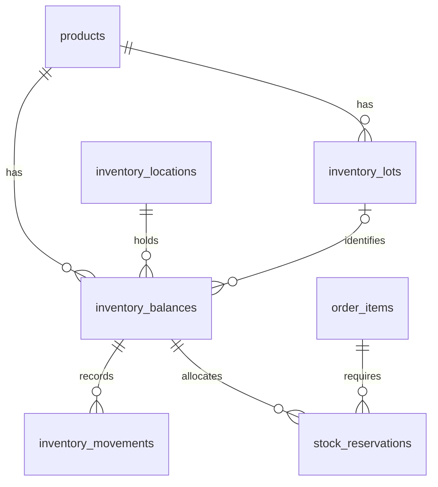
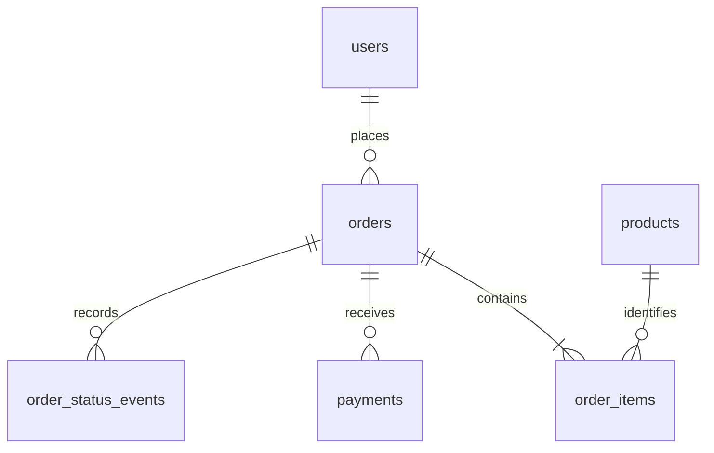

# Pharmacy ecommerce data model proposal

The commercial catalog, operational inventory, orders, reservations and
Better Auth pilot are implemented. The web catalog and local cart use sample
data. The pilot API supports eligible orders with an authenticated buyer.
Prescription review, payment integration and web checkout remain proposed.
See the [current data model](data-model.md) for the implemented schema.

## Goal and scope

Build a new system for buying pharmacy products, centered on orders, payments
and operational inventory. The Excel workbook and other [source materials](context/README.md)
provide reference information and possible initial data; they are not the new
system's operating model or an ongoing source of truth for checkout.

The model separates product definitions, physical stock, reservations, stock
movements and purchase records. It also supports the prescription review
needed for applicable products. Production identity integration, the payment
provider and prescription policies still require decisions.

## Catalog

| Table | Purpose and principal data |
| --- | --- |
| `products` | Unique product code, required display name, optional additional description, active ingredient label, dosage form, presentation, sale/counting unit, current selling price, sale condition and publication status. |
| `suppliers` | Reviewed supplier labels associated with the catalog. |
| `therapeutic_categories` | Categories used to classify and filter products. |

Each distinct sellable presentation is a product. Different package sizes may
have different codes, prices and stock even when they share an active
ingredient. Supplier and category links retain the existing optional catalog
relationships; this proposal does not add a procurement system.

### Commercial product fields

These fields are implemented in the schema and `0001_commercial_catalog.sql`.
Existing supplier, category and inventory relationships remain. This unreleased
model removes the old prescription boolean without a compatibility layer.

| Database field | Type | Rule |
| --- | --- | --- |
| `id` | UUID | Generated internal primary key |
| `code` | Text | Required, unique and without surrounding whitespace |
| `name` | Text | Required nonblank product name displayed in the catalog |
| `description` | Text | Optional additional description; null when absent |
| `quantity_unit` | Text | Required verified sale/counting unit |
| `active_ingredient` | Text | Nullable source label, including strength or combinations when supplied |
| `dosage_form` | Text | Nullable when missing or not applicable |
| `presentation` | Text | Nullable product presentation; not an automatic unit conversion |
| `supplier_id` | UUID | Nullable reference to `suppliers` |
| `therapeutic_category_id` | UUID | Nullable reference to `therapeutic_categories` |
| `sale_condition` | Controlled enum | Nullable while classification is pending; replaces `requires_prescription` |
| `price_clp` | Integer | Nullable while pending; strictly positive when defined |
| `is_published` | Boolean | Required, initially false |

Optional text accepts null, not empty or whitespace-only strings. `name` is the
display title; `description` holds additional details and must not be the only
place where a product's name exists.

Store monetary amounts in whole Chilean pesos for the initial CLP storefront.
Publication requires a valid name, positive price and reviewed sale condition.
Unknown sale conditions remain null and block publication; there is no default
of direct sale. Define tax and delivery-fee treatment before price calculations.
Publication and stock availability do not by themselves authorize checkout.

### Chilean sale conditions

Reviewed on 2026-10-30. Article 32 of [DS 466](https://www.bcn.cl/leychile/navegar?idNorma=13613&idVersion=2025-11-03)
defines four base conditions: direct sale, simple prescription, retained
prescription and prescription cheque. The proposed application values also
distinguish retained prescriptions requiring stock control, addressed by
[DS 405, articles 18 and 23](https://www.bcn.cl/leychile/navegar?idNorma=13066).

| Proposed `sale_condition` | Spanish display label | Interpretation |
| --- | --- | --- |
| `direct_sale` | Venta directa | VD; no prescription |
| `simple_prescription` | Receta médica simple | R |
| `retained_prescription` | Receta médica retenida | RR without the additional stock-control classification |
| `retained_prescription_stock_control` | Receta médica retenida con control de stock | Operational distinction within RR |
| `prescription_cheque` | Receta cheque | RCH |
| `not_applicable` | No aplica | Application-only value for verified non-pharmaceutical goods; not a legal medication condition |

`null` means unresolved, not direct sale or not applicable. The RR subtype must
also be reviewed: do not choose ordinary retained prescription merely because
the source omits its stock-control requirements. These English identifiers are
application design choices, not additional statutory categories.

Assign the condition from the particular product's approved registration and
label, reviewed by authorized pharmacy staff. Do not infer it from an active
ingredient name, the frontend mock or a legacy boolean.

DS 466, article 87 E, excludes prescription-cheque medicines from electronic
sale. Therefore checkout must reject `prescription_cheque`, independently of
catalog visibility. Other prescription conditions require their own supported
review and retention workflows; a non-null classification is not sufficient
authorization to sell.

Prescription medium belongs to the document, not the product's sale condition.
DS 466, articles 33 and 38, distinguish physical/electronic documents and
magistral prescriptions. A magistral preparation needs a separate preparation
workflow; it is not a fifth base sale condition. No signature-validation or
document-retention mechanism is implemented by this proposal.

The ISP's [electronic-sale guidance, Resolution 1843/2024](https://www.ispch.gob.cl/wp-content/uploads/resoluciones/33635_Resoluci%C3%B3n%20Exenta%20N%C2%B01843-2024.pdf)
also identifies retained prescriptions with stock control. Its indexed excerpts
were available during this review, but the complete PDF could not be retrieved;
the legal classification above is grounded in the retrieved DS 466 and DS 405.

### Commercial catalog implementation

- The new migration adds required `name`, optional description, the controlled
  sale-condition enum, positive integer CLP prices and unpublished-by-default
  products. Price and classification may remain null until publication.
- The application is unreleased. The migration removes `requires_prescription`
  instead of archiving it or inferring new classifications from old values.
  It targets a fresh database and has no name backfill or data reset.
- Database constraints reject blank names/descriptions, invalid prices, unknown
  conditions and publication with incomplete commercial data.
- Integration tests cover valid conditions, defaults, publication changes,
  invalid inputs and the complete migration chain in an isolated schema.
- The frontend mock remains unchanged; no public HTTP contract has been added.
  Future checkout tests must independently reject prescription-cheque products
  and unsupported prescription-review flows.

## Operational inventory

| Table | Purpose and principal data |
| --- | --- |
| `inventory_locations` | Implemented: physical locations and active flag. |
| `inventory_lots` | Implemented: product, lot identifier and mandatory expiration date. |
| `inventory_balances` | Implemented product, location, lot, physical and reserved quantities and blocked flag. |
| `inventory_movements` | Implemented audit records for openings, receipts, adjustments, transfers and order fulfillment. |
| `stock_reservations` | Implemented item, balance, quantity, state and sale movement link. The unpaid deadline belongs to the order. |

A product can have stock in multiple locations and lots. An order item can have
multiple reservations when its quantity is allocated across several eligible
balances. A balance's lot must belong to that same product. The implemented
`products.inventory_tracking` is `quantity_only`, `lot_and_expiration` or null
while pending. Assign it explicitly before creating stock. Do not infer it
from product names or invent lot numbers or dates for missing source data.

The implemented stage includes idempotent transactional operations and
availability queries in the API module, without HTTP endpoints. Available
stock excludes inactive locations, blocked balances and lots expiring today
or earlier, using the `America/Santiago` date. The
[current model](data-model.md#operational-services-and-availability) details the
implemented constraints and policies. The internal order lifecycle maintains
the reserved quantity alongside its active allocations.

### Quantities and integrity

- Physical and reserved quantities cannot be negative.
- Reserved quantity cannot exceed physical quantity.
- An order item's quantity and each reservation quantity must be positive.
- Maintain one balance per product, location and applicable lot. The unique
  key must also prevent duplicates for items with no lot.
- All quantities for a product use its verified canonical unit. A box and a
  tablet cannot be added together without an approved conversion.
- Sellable availability is physical minus reserved quantity, calculated only
  over stock eligible for sale. Expired or blocked stock is excluded even if
  it remains physically present.

Balances support fast stock queries. Movements explain changes to physical
quantities. Update them together in a transaction; correct history with
compensating movements instead of silently rewriting past movements.
Transfers require linked source and destination changes in the same transaction.
Define an explicit opening-stock operation rather than treating an arbitrary
spreadsheet snapshot as a sale-ready balance.

Reservation changes must also update reserved quantities transactionally. A
stored expiration time does not release units by itself: a controlled process
must release eligible unpaid reservations. Paid allocations must not be
released by the unpaid-reservation expiration process.

## Users, orders and payments

| Table | Purpose and principal data |
| --- | --- |
| `users`, `user_roles` | Implemented internal identity, Better Auth session mapping and auditable role assignments. |
| `orders` | Implemented buyer, number, lifecycle state, fulfillment details, exact totals and reservation deadline. |
| `order_items` | Implemented product, quantity, and snapshots of code, name, unit, sale condition and unit price. |
| `payments` | Proposed payment attempts, amount, state, provider reference and idempotency identifiers. |
| `order_status_events` | Implemented immutable transitions with timestamp, actor, reason and operation ID. |

The proposed initial purchase flow associates each order with an identified
buyer. Define roles and resource-level permissions in the backend. Do not use
an order number as the sole authorization factor for private order information.
Credentials belong to the selected authentication system; never store plaintext
passwords in user records.

An order contains one or more items and can have multiple payment attempts.
The server validates quantities and calculates amounts using approved product
prices. Browser-submitted totals are not authoritative. Current catalog prices
must not change historical order item prices, and profile changes must not
rewrite historical delivery details.

Verify payment confirmations on the server through the selected provider's
supported mechanism. Authenticate events or query provider status as required
by that integration. Record provider references and process repeated
confirmations idempotently so they do not produce duplicate order transitions,
reservations or stock issues.

## Prescriptions

A purchase request would associate the requested items with private
prescription files. An authorized operator would record a decision for each
item, the approved quantity, reviewer and review timestamp. The proposed
sequence reviews the prescription before creating the order or reserving
stock. The resulting order items would reference the approvals used for
checkout. Document medium and the product's `sale_condition` represent
different attributes.

Prescription contents belong in private storage. Access checks must cover
the specific buyer, request and authorized staff. Use synthetic documents
in Git and tests. The frontend's experimental text matcher is disconnected
from the cart and backend. It searches names and text and provides no
evidence of authenticity or pharmacy approval.

## Purchase and stock lifecycle

1. Adding a product to a cart does not reserve stock in the proposed initial
   flow. The cart is not an authoritative inventory allocation.
2. At checkout, the backend revalidates product publication, prices, quantities,
   sellable stock, sale-condition eligibility and prescription requirements.
   Prescription-cheque products cannot enter the electronic purchase flow.
3. Create the order, item snapshots and reservations in one transaction. Serialize
   conflicting stock updates so two buyers cannot reserve the same last unit.
4. While payment is pending, allocations have a defined expiration. Cancellation
   or expiration of an unpaid order releases its reservations transactionally.
5. A verified successful payment confirms the order and keeps its stock allocated.
   The unpaid-expiration process must no longer release that allocation.
6. At physical dispatch or handover, create the stock issue, reduce physical
   quantity and consume the reservation in the same transaction, exactly once.
7. Record the corresponding order status event with each successful transition.

For products requiring review, obtain approval before checkout revalidates
stock and starts the payment deadline. A late payment requires reconciliation
with current availability. A paid cancellation follows the refund policy.

### Example

Assume one eligible stock balance contains 50 units and a buyer orders 8.

| Event | Physical | Reserved | Available |
| --- | ---: | ---: | ---: |
| Before checkout | 50 | 0 | 50 |
| Checkout reserves 8 units | 50 | 8 | 42 |
| Payment is confirmed | 50 | 8 | 42 |
| Dispatch or handover completes | 42 | 0 | 42 |

If the unpaid reservation expires instead, physical stock stays at 50,
reserved stock returns to zero and availability returns to 50. Do not deduct
physical stock once at payment and again at dispatch.

## Existing historical tables

`monthly_product_consumption` and `inventory_snapshots` are optional analytical
or reconciliation inputs. They do not authorize purchases, reserve units or
determine live sellable availability. An approved import or opening-stock
process would be needed to initialize the operational inventory from reference
data. No such import is implemented by saving this proposal.

The historical tables and initial migration remain unchanged. The commercial
catalog is added by its separate migration. The user's decision to omit legacy
data compatibility applies to this unreleased catalog change; it is not an
instruction to reset databases or to rewrite migrations in a shared deployment.

## Decisions before implementation

- Assign the implemented tracking policy per product and verify opening counts.
  Products without required lot information cannot receive operational stock.
- Define the request, document and item approval schema for the proposed
  prescription review before checkout.
- Verify product-specific sale conditions and the workflows supported for
  simple, retained and stock-controlled retained prescriptions before checkout.
- Configure the unpaid reservation duration and schedule the implemented expiry batch.
- Confirm production identity integration and the source of verified pharmacy enrollment.
- Select the payment provider and define confirmation, late-payment,
  cancellation and refund behavior.
- Define collection and delivery operations and the authoritative pricing and
  opening-stock workflows.

Verification for the eventual implementation must cover simultaneous checkout
for the last unit, duplicate payment confirmations, expiry/payment races,
single stock deduction, rollback on failure and resource-level authorization.
These are required implementation checks, not tests completed by this document.
