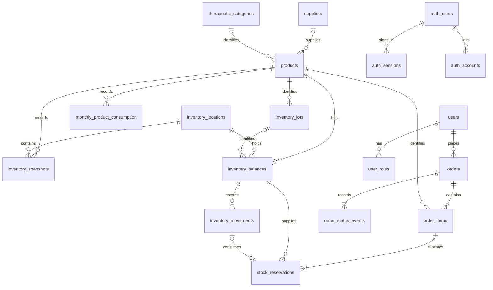

# Resumen de Integración: Base de Datos, Catálogo, Carrito y Autenticación

Este documento resume los cambios realizados en el modelo de datos y backend (`packages/database` y `apps/api`) y cómo fueron integrados con la interfaz del vecino (`apps/web`).

---

## 1. ¿Cómo funciona la persistencia de la Base de Datos?

- **En desarrollo local (`pnpm dev`)**: PostgreSQL 17 corre en Docker y almacena los datos en un volumen persistente (`farmacia-comunitaria_postgres_data`). Cada vez que se inicia el entorno, el contenedor `migrate` aplica únicamente las migraciones nuevas de `packages/database/migrations/` sin borrar ni recrear las tablas ni los datos existentes.
- **En despliegues a producción**: Las migraciones son incrementales (`db:migrate`). Nunca se borra la base de datos al hacer deploy; los usuarios, pedidos, reservas y movimientos de inventario quedan almacenados permanentemente.
- **En GitHub Actions (CI)**: Es el único entorno donde se levanta una base de datos efímera desde cero (`farmacia-ci`) para ejecutar las pruebas automáticas y se elimina al finalizar.

---

## 2. Las 17 tablas creadas en PostgreSQL (`packages/database/src/schema/`)

El esquema está dividido en **5 bloques de negocio**:



### A. Catálogo Comercial (`products.ts`)
1. **`suppliers`**: Proveedores o laboratorios (`id`, `name` único sin importar mayúsculas/espacios).
2. **`therapeutic_categories`**: Categorías terapéuticas (`id`, `name` único, ej. *CARDIOVASCULAR*, *SALUD MENTAL*).
3. **`products`**: Medicamentos e insumos del catálogo:
   - `id` (UUID interno) y `code` (código externo único del Excel municipal).
   - `name`, `description`, `active_ingredient`, `dosage_form`, `presentation`, `quantity_unit`.
   - `supplier_id` y `therapeutic_category_id`.
   - `sale_condition`: Condición de venta ISP (`direct_sale`, `simple_prescription`, `retained_prescription`, `retained_prescription_stock_control`, `prescription_cheque`, `not_applicable`).
   - `price_clp` (precio entero positivo en CLP), `is_published` (booleano) e `inventory_tracking` (`quantity_only` o `lot_and_expiration`).

### B. Inventario Operativo en Tiempo Real (`operational-inventory.ts`)
4. **`inventory_lots`**: Lotes de productos con fecha de vencimiento (`lot_number`, `expires_on`).
5. **`inventory_balances`**: Stock físico (`on_hand_quantity`), stock reservado por pedidos en curso (`reserved_quantity`) e indicador de bloqueo (`is_blocked`) por producto, bodega y lote.
   - El **stock disponible** para los vecinos se calcula como `on_hand_quantity - reserved_quantity`.
6. **`inventory_movements`**: Kardex auditable e inmutable de movimientos (`opening`, `receipt`, `sale`, `adjustment`, `transfer_in`, `transfer_out`).

### C. Historial de Planillas Municipales (`inventory.ts`)
7. **`inventory_locations`**: Bodegas o sucursales de la farmacia (`code`, `name`, `is_active`).
8. **`inventory_snapshots`**: Fotografías históricas de stock importadas de planillas con hash SHA-256, hoja y fila de origen.
9. **`monthly_product_consumption`**: Registro histórico de consumo mensual por producto.

### D. Pedidos y Reservas de Stock (`orders.ts`)
10. **`orders`**: Solicitudes de compra con número correlativo (`FC-1`, `FC-2`, ...), comprador (`buyer_id`), estado (`pending_payment`, `confirmed`, `fulfilled`, `cancelled`, `expired`), modalidad de entrega (`pickup` retiro en farmacia o `delivery` despacho a domicilio con snapshot de dirección), montos (`subtotal_clp`, `delivery_fee_clp`, `total_clp`) y vencimiento de la reserva (`reservation_expires_at`).
11. **`order_items`**: Ítems de cada pedido, guardando copia fija (*snapshot*) del nombre, código, unidad, precio unitario y condición de venta al momento de realizar la solicitud.
12. **`stock_reservations`**: Reservas que bloquean unidades de `inventory_balances` al crear un pedido (`active`, `released`, `consumed`), priorizando los lotes más próximos a vencer (FEFO).
13. **`order_status_events`**: Bitácora auditable de cada cambio de estado del pedido.

### E. Usuarios, Roles y Autenticación (`users.ts` y `auth.ts`)
14. **`users`** y **`user_roles`**: Usuarios del dominio y sus roles (`buyer` vecino comprador, `pharmacy_operator` operador de farmacia, `user_admin` administrador) con historial de otorgamiento y revocación.
15. **`auth_users`**, **`auth_sessions`**, **`auth_accounts`**, **`auth_verifications`**: Tablas de **Better Auth** para inicio de sesión mediante código de verificación de 6 dígitos enviado al correo (Email OTP).

---

## 3. Cambios implementados para integrar el Frontend con el Backend y PostgreSQL

### A. Nuevo módulo de Catálogo y Seed inicial en la API (`apps/api/src/modules/catalog/`)
- **`catalog.service.ts`**:
  - `ensureInitialCatalog(db)`: Al arrancar la API con `DATABASE_URL`, verifica de forma idempotente si existe la ubicación `"Farmacia Comunitaria Peñalolén"` (`PENALOLEN-CENTRAL`) y los 6 medicamentos iniciales del catálogo. Si no están cargados aún, crea los proveedores, categorías, productos, balances e inserta los movimientos de apertura (`opening`) en PostgreSQL.
  - `listPublishedCatalog(db)`: Consulta todos los productos publicados en `products` junto a su proveedor, categoría terapéutica y su stock disponible en tiempo real (`on_hand_quantity - reserved_quantity`).
- **`catalog.routes.ts`**:
  - Expone `GET /api/catalog` para que la aplicación web consulte el catálogo real desde PostgreSQL.

### B. Activación del botón "Iniciar sesión" (`AccountPanel`) en desarrollo local
- **`apps/api/src/server.ts` y `apps/api/src/modules/auth/access-routes.ts`**:
  - Originalmente, las rutas `/api/me`, `/api/auth/*` y `/api/orders` solo se registraban si existía un servidor SMTP externo configurado en `.env.local`; de lo contrario, `/api/me` respondía `404` y `AccountPanel.tsx` ocultaba el botón **"Iniciar sesión"**.
  - Ahora, cuando `DATABASE_URL` está configurada en desarrollo local sin SMTP externo, el servidor activa automáticamente las rutas de autenticación y pedidos sobre PostgreSQL, acepta tanto `127.0.0.1` como `localhost`, asigna el rol `buyer` al usuario autenticado en local y muestra el código OTP de 6 dígitos en un aviso de desarrollo dentro de `AccountPanel.tsx` para poder probar el flujo completo sin depender de un servidor de correo externo.

### C. Conexión del Catálogo, Validador de Recetas y Carrito con PostgreSQL (`apps/web/src/features/catalogo/`)
- **`CatalogoPage.tsx`**:
  - Consulta `GET /api/catalog` al cargar la página y después de confirmar cada pedido, mostrando el stock real de PostgreSQL (y deshabilitando el botón cuando un producto queda sin stock).
- **`CarritoPanel.tsx` y `apps/api/src/modules/orders/`**:
  - Se integró `validadorRecetas.ts` (`analizarRecetaMedica`) dentro del carrito cuando existen medicamentos sujetos a receta médica (`requiereReceta`), solicitando adjuntar el archivo PDF o imagen de la receta antes de confirmar.
  - Se agregó la selección de modalidad de entrega (**Retiro en Farmacia $0** o **Despacho a Domicilio +$1.500** con captura de nombre, teléfono, dirección y comuna).
  - El botón **"Confirmar Solicitud de Compra"** envía la solicitud real a `POST /api/orders`, registra el pedido en las tablas `orders`, `order_items`, `stock_reservations` y `order_status_events`, muestra el número de orden asignado (`FC-1`, `FC-2`, ...) y actualiza inmediatamente el stock disponible en el catálogo.

---

## 4. Cómo probar todo en otro computador

1. Clonar el repositorio y cambiar a la rama `vecino-vista`:
   ```sh
   git checkout vecino-vista
   git pull origin vecino-vista
   ```
2. Levantar el entorno completo en Docker:
   ```sh
   pnpm dev
   ```
3. Abrir `http://127.0.0.1:5173`:
   - Arriba a la derecha hacer clic en **"Iniciar sesión"**, escribir cualquier correo (ej. `vecino@penalolen.cl`) y presionar **"Enviar código"**.
   - El código de 6 dígitos aparecerá autocompletado en el recuadro azul de modo desarrollo; presionar **"Ingresar"**.
   - Agregar medicamentos al carrito (si incluyen receta médica, adjuntar un archivo PDF o imagen en el carrito), elegir Retiro o Despacho y hacer clic en **"Confirmar Solicitud de Compra"**.
   - Verás el número de orden creado (`FC-...`) y cómo el stock disminuye en tiempo real y se mantiene guardado en PostgreSQL incluso al recargar la página.
